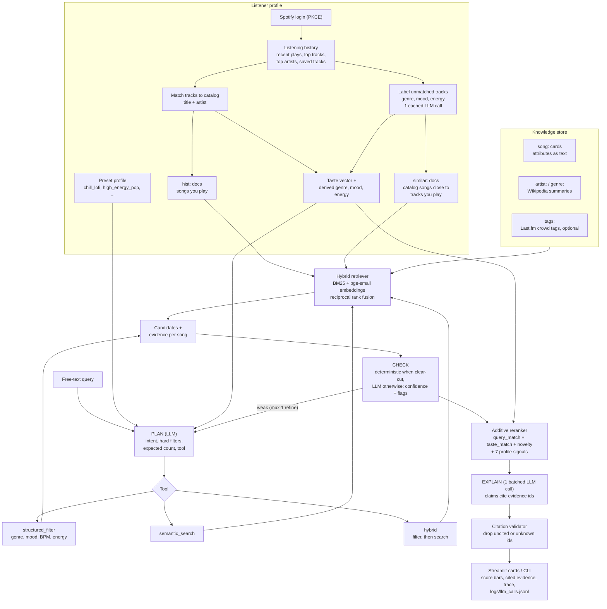

# Applied AI Music Recommender System

This project extends my rule-based deterministic music recommender into an agentic, retrieval-augmented recommender. It accepts free-text requests, retrieves candidate songs with a hybrid search over a small knowledge store, checks whether the results make sense, ranks them with a transparent additive scorer, and explains every pick with claims that cite their evidence. If you log in with Spotify, your listening history becomes part of both the ranking and the evidence ("sounds similar to a song you play").

The original project was a deterministic content-based recommender built around `Song`, `UserProfile`, and a weighted scoring function. Given a structured profile, it ranked songs by genre, mood, energy, acousticness, danceability, valence, and popularity. This extension keeps that scoring backbone, but adds an LLM-driven agent (Claude) to plan from free text, choose a retrieval strategy, judge candidate quality, and generate grounded explanations.

## New Additions

- **Agentic workflow:** `plan -> act -> check -> refine -> rank -> explain`, with every step recorded in a trace.
- **Explainable RAG:** a hybrid retriever (BM25 + dense embeddings, fused with reciprocal rank fusion) over song cards plus Wikipedia artist and genre summaries.
- **Additive, inspectable ranking:** `score = Σ weight × signal`. The per-signal bars in the UI add up exactly to the score.
- **Cited explanations:** the explainer must attach evidence ids to every claim. A deterministic validator drops any claim that cites nothing or cites evidence that wasn't retrieved for that song.
- **Spotify personalization:** PKCE login, listening history turned into a taste vector, a derived profile, and citable `hist:` / `similar:` evidence.
- **Evaluation harness:** 24 labeled queries, a retrieval ablation, end-to-end precision, citation validity, LLM-judge faithfulness, and per-stage latency.
- **Offline mode:** without an API key, everything still runs with a heuristic planner, deterministic checks, and template explanations built from the same evidence.

## Architecture Overview

There are two entry points, a CLI and a Streamlit app. Both send a free-text query and a listener profile (a preset or your Spotify profile) into the same pipeline.



In plain language: the LLM decides how to search, judges whether the results fit, and writes the explanations. Retrieval, ranking, and citation checking are deterministic code, so the final order is reproducible and every sentence in an explanation can be traced back to a retrieved document or a score signal.

### How the agent works

| Step | What happens | LLM? |
|---|---|---|
| **Plan** | Turns the query into an intent, optional hard filters (genre, mood, BPM, energy, instrumental), an expected result count, and a tool choice. | 1 call (heuristic planner offline) |
| **Act** | `structured_filter` applies the hard filters in code. `semantic_search` runs the hybrid retriever. `hybrid` filters first, then searches inside the filtered set. | none |
| **Check** | Judges the candidate set: a confidence score plus flags (`looks_good`, `low_result_count`, `constraint_violated`, `intent_mismatch`). Clear-cut cases are decided in code. | 0–1 call |
| **Refine** | If the check is weak, the agent relaxes filters or switches tools, then tries once more. | reuses Plan |
| **Rank** | Additive reranker (below). | none |
| **Explain** | One batched call writes 2–3 short claims per song. Each claim lists the evidence ids it relies on. | 1 call (template offline) |

A typical query makes about 3 LLM calls and takes ~15 s end to end with Claude (see [Evaluation](#evaluation)). `--fast` / the UI's "Recommend fast" toggle runs check and explain on Haiku.

### How RAG fits in

- **Documents.** Every song has a `song:{id}` card that renders its numbers as words ("slow tempo", "acoustic", "dark, sad tone"), so both keyword and embedding search can match vibe queries. `scripts/build_knowledge.py` adds `artist:` and `genre:` summaries from Wikipedia, and Last.fm `tags:` if `LASTFM_API_KEY` is set.
- **Retrieval.** BM25 catches exact terms (artist names, "lofi"). Dense search with `BAAI/bge-small-en-v1.5` (local, via fastembed) catches meaning. Reciprocal rank fusion merges them, and each hit keeps its BM25 rank, its dense rank, and the query terms it matched, so the UI can show *how* a song was found. Vectors are cached on disk by text hash.
- **Evidence.** For every candidate, the retriever returns the documents that support it. Those documents, plus the song's score signals (`sig:energy`, `sig:query_match`, ...), are the only things the explainer is allowed to cite.
- **Ranking.** `score = 0.5·query_match + 0.15·taste_match + 0.05·novelty + Σ wᵢ·profile_signalᵢ`. Profile signals only count when the listener actually stated that preference.

### How Spotify connects

Spotify feeds the same pipeline at three points: the **profile**, the **ranking**, and the **evidence**.

1. **Fetch.** After login (PKCE, no client secret), the app reads your recent plays, top tracks and top artists across three time ranges, and saved tracks. That's 7 API calls. Each track gets a weight: top tracks count more, and so do repeat plays.
2. **Match.** History tracks are matched to the catalog by normalized title and artist. Matched songs bring real audio features and become `hist:{id}` evidence ("in your top tracks, saved in your library").
3. **Label.** Spotify no longer returns audio features to new apps, and returns genres for only a few artists. So the tracks that aren't in the catalog get labeled with the catalog's own vocabulary (genre, mood, energy, valence, acousticness) by one batched fast-model call. Labels are cached per track, so later logins only label new tracks. Offline, the nearest catalog songs stand in for the labels.
4. **Profile.** The weighted labels and matches give a derived profile (top genre and mood, average energy and valence, acoustic preference). That profile replaces the preset, so the 7 profile signals work for you.
5. **Taste vector.** A weighted average of the history embeddings. It adds a `taste_match` signal to every candidate.
6. **Novelty.** Songs you've played recently get no novelty bonus, which nudges discovery.
7. **`similar:` evidence.** Each catalog song is linked to the history track it sounds closest to, within the same genre and compared without titles (titles alone produced false matches like "Feeling Good" ~ "Feel Your Rain"). The explainer can then say *Sounds similar to "Euphoria" by BTS, which you listen to* and cite `similar:{id}`.

Tokens live in `.spotify_tokens.json` (gitignored, file mode 600) and refresh automatically. The CLI and Streamlit share them.

## Design Decisions

- **The scorer stays the ranking authority.** The LLM never orders songs. This trades some flexibility for reproducibility and easy testing.
- **Additive scoring instead of a black-box blend.** Every point of a song's score is attributable to one named signal, which is what makes the explanations checkable.
- **Local hybrid retrieval instead of an LLM reading the whole catalog.** The original `semantic_search` sent all 180 songs to the model on every search. The hybrid retriever matches or beats it on precision at about 1/150th of the latency (see the ablation). The LLM backend is kept behind `RECOMMENDER_SEMANTIC_BACKEND=llm` for comparison.
- **Citations are validated in code, not trusted.** Dropped claims are kept in the trace so model drift is visible.
- **No hosted vector database.** With a few hundred documents, NumPy cosine search is milliseconds. A vector DB would add infrastructure without changing results.
- **One LLM call to label Spotify history, cached.** Without it, unmatched tracks were embedded from their titles alone, and the derived profile came out as `jazz` for a listener whose history is mostly pop. It runs once per new track, never on the query path.
- **Bounded refinement.** At most one refine, so a single request can't turn into an unbounded chain of retries.

The main trade-off is that the system is more expressive on free-text requests, but its live path depends on API availability and prompt quality. The offline path keeps it usable and testable without either.

## Setup Instructions

### Prerequisites

- Python 3.12+ and [uv](https://docs.astral.sh/uv/)
- Optional: a Claude API key (`ANTHROPIC_API_KEY`) or an `ant auth login` profile. Without one the app runs fully offline.
- Optional: a Spotify developer app for personalization.

### Installation

```bash
git clone https://github.com/sunitab55/applied-ai-music-recommender-system.git
cd applied-ai-music-recommender-system
uv sync
```

Create a `.env` file in the project root. Every setting is optional:

```env
ANTHROPIC_API_KEY=your_key_here

# Model overrides (defaults: claude-opus-5-5 everywhere; fast mode uses claude-haiku-5-5)
RECOMMENDER_MODEL=claude-opus-5-5
RECOMMENDER_FAST_MODE_MODEL=claude-haiku-5-5

# Spotify personalization. Create an app at developer.spotify.com/dashboard
# (owner needs Premium; max 5 allowlisted users) and register both redirect URIs:
#   http://127.0.0.1:8501            (Streamlit)
#   http://127.0.0.1:8888/callback   (scripts/spotify_login.py; --port N for another)
SPOTIFY_CLIENT_ID=your_client_id

# Last.fm crowd tags for the RAG knowledge store (scripts/build_knowledge.py)
LASTFM_API_KEY=your_key
```

### Run The App

```bash
uv run streamlit run streamlit_app.py                                     # UI
uv run python -m src.recommender.main --query "chill study music, no vocals" --profile chill_lofi
```

CLI options:

- `--k 5`: number of recommendations
- `--spotify`: use your Spotify profile instead of a preset (log in first, see below)
- `--fast`: check and explain on the smaller model
- `--no-llm-explainer`: template explanations only
- `--songs data/songs.csv`: a different catalog file

### Connect Spotify

- **Streamlit:** click **Connect Spotify** in the sidebar, approve, and pick the **Your Spotify** profile.
- **CLI:** run `uv run python scripts/spotify_login.py`, open the printed link, and approve. The script prints your derived taste profile. Use `--profile` to reprint it later without logging in again.
- **Remote machine:** if the code runs on another machine (SSH, VS Code Remote), port forwarding has to carry the redirect back. VS Code does this automatically; open `http://127.0.0.1:8888/` there and it redirects to the Spotify login. If the redirect still can't reach the script, paste the `http://127.0.0.1:8888/callback?code=...` address from the browser into the terminal.

### Rebuild The Knowledge Store And Run Evals

```bash
uv run python scripts/build_knowledge.py     # Wikipedia (+ Last.fm) docs -> data/rag/
uv run python scripts/run_eval.py            # offline eval -> eval/results.md
```

### Run Tests

```bash
uv run pytest
```

63 tests, fully offline: LLM calls and Spotify HTTP are mocked, and retrieval uses a deterministic hashing embedder.

## Sample Interactions

These are live runs with Claude on the 180-song catalog.

### 1. Workout Pop

- **Query:** `upbeat pop for a workout`
- **Profile:** High-Energy Pop
- **Plan:** `hybrid`, filters `genre=pop`, `energy ≥ 0.7`. **Check:** `looks_good`, confidence 0.85.
- **Results:**
  - **`As It Was` by Harry Styles:** "Top match for your upbeat pop workout query, hitting upbeat, energetic and pop keywords... Its 0.73 energy sits a bit below your 0.88 target."
  - **`Sweater Weather` by The Neighbourhood:** "Energy of 0.81 lands close to your 0.88 target... Its mood is intense rather than happy, which earned no mood points."

### 2. Intense Night Listening (refine loop)

- **Query:** `intense late-night rock`
- **Profile:** Deep Intense Rock
- **First pass:** `hybrid` with `genre=rock`, `mood=intense` returned 4 songs. Check flagged `intent_mismatch` (confidence 0.60): two were not dark, late-night rock.
- **Refine:** switched to `semantic_search` without filters, which returned 10 candidates.
- **Results:**
  - **`Thunder` by Imagine Dragons:** "a near-perfect query match, hitting intense, dark, driving and rock..."
  - **`Sex, Drugs, Etc.` by Beach Weather:** "Beach Weather is an American indie rock band best known for this Platinum-certified song." This claim cites the `artist:` Wikipedia doc.

### 3. Guardrail Example

- **Query:** `songs from a fake genre`
- **Profile:** Chill Lofi
- **Check:** `intent_mismatch`, confidence **0.35**. The agent tried to refine, found nothing better to switch to, and returned the closest matches.
- **Results:** the explanations say so plainly. For example: "Closest match available for a genre that doesn't exist: top retrieval hit, though it's conventional ambient, not experimental."

### 4. Spotify-Personalized

- **Query:** `upbeat songs to get ready for a night out`
- **Profile:** Your Spotify (derived as pop / melancholic from 132 history tracks)
- **Results:** cards cite the listener's history.
  - "Resembles BTS's 'Euphoria', a song from your listening." (`similar:94`)
  - "Matched your query on 'love' and is already in your top tracks." (`hist:79`)

## Evaluation

`scripts/run_eval.py` runs 24 labeled queries (`eval/queries.json`). These are live numbers with Claude, from `eval/live/results.md`.

**Retrieval ablation**

| System | P@5 | nDCG@10 | Recall@20 | MRR | p50 latency |
|---|---|---|---|---|---|
| LLM reads whole catalog | 0.767 | 0.779 | 0.660 | 0.734 | 1794 ms |
| BM25 | 0.675 | 0.685 | 0.627 | 0.735 | 12 ms |
| Dense | 0.700 | 0.691 | 0.707 | 0.840 | 12 ms |
| **Hybrid (BM25 + dense, RRF)** | **0.775** | 0.762 | **0.707** | **0.856** | **12 ms** |

**End to end** (agent, k=5, neutral profile)

| Metric | Value |
|---|---|
| P@5 | 0.792 |
| LLM calls per query | 3.17 |
| Citation validity (claims kept by the validator) | 1.000 |
| Faithfulness (LLM judge) | 0.851 |

| Stage | p50 ms | p95 ms |
|---|---|---|
| plan | 2532 | 3614 |
| retrieve | 20 | 39 |
| check | 2866 | 5972 |
| explain | 8773 | 11110 |
| **total** | **14429** | **17640** |

Explanation is the slowest stage. The Streamlit UI shows ranked cards with template text right away and fills in the LLM narratives when they arrive.

## Reliability And Testing Summary

- **Structured outputs:** every LLM response (plan, check, explanations, Spotify labels) is a Pydantic-validated structured output.
- **Logging:** every LLM call goes through one client and is logged to `logs/llm_calls.jsonl` with model, latency, and token usage. Prompts are not logged.
- **Citation validation:** claims with missing or unknown evidence ids are dropped and recorded in the trace.
- **Fallbacks:** each LLM step has an offline fallback (heuristic plan, deterministic check, template explanation, embedding-neighbour profile), so an API error degrades the output instead of breaking it.
- **Tests:** 63 automated tests cover scoring, tools, the retriever, citations, the agent loop, the explainer, the Spotify auth/client/profile code, and history labelling.

What did not work cleanly:

- Latency is ~15 s per query with Claude, above my 5 s goal. Most of it is the explain step.
- Only a small share of a real listener's history is in the 180-song catalog (1 of 132 tracks in my test), so most personal evidence is `similar:` rather than `hist:`.
- The Spotify history labels are LLM estimates, not measured audio features.
- Very narrow or contradictory constraints still produce sparse candidate sets.

What I learned:

- Reliability features are not optional extras in AI systems; they are part of the product.
- A small deterministic core paired with an LLM orchestration layer is easier to evaluate than an all-LLM recommender.
- Surfacing uncertainty helps users trust the system more than hiding failure states.

## Reflection

This project taught me that building with AI is less about asking a model for an answer and more about designing a workflow around uncertainty. The most important shift from the earlier modules was not just "adding an LLM," but deciding where the model should have freedom and where the system should stay deterministic. Letting the agent interpret free-text intent was valuable; letting it control the final ranking would have made the system much harder to debug and justify.

It also highlighted the limitations and biases of small recommendation systems. The catalog is limited, so some genres or moods are underrepresented. That means the agent can understand a request correctly and still fail to satisfy it because the data is weak. The system could also be misused if someone assumed the recommendations were personalized at Spotify-scale; to reduce that risk, I expose the trace, the confidence score, and the recommendation rationale instead of presenting the output as magically authoritative.

My collaboration with AI during development was useful but not flawless. One helpful suggestion was separating the workflow into plan, check, and explain stages while keeping the original rule-based scorer in charge of ranking; that made the system much easier to test. One flawed suggestion was an earlier configuration path that pointed at the wrong provider-style setup, which would have sent the project toward mismatched environment-variable and model assumptions. Correcting that reinforced an important lesson: AI can accelerate design and debugging, but it still needs human review, especially around architecture and integration details.

## Future Improvements

- Import a listener's top tracks into the catalog (with clearly labeled estimated features) so more recommendations can cite real plays
- An "exclude recently played" toggle, and a counterfactual view: remove a history track or zero out a signal, then see which songs move
- Last.fm crowd tags in the knowledge store
- Bring p50 latency under 5 s, mainly by shortening the explain step
- A demo video and screenshots of the evidence panel

## Portfolio Notes

- GitHub repository: https://github.com/sunitab55/applied-ai-music-recommender-system
- Loom walkthrough: add your Loom link here when the demo video is ready
- What this project says about me as an AI engineer: I care about building AI systems that are inspectable, testable, and honest about uncertainty rather than just impressive at first glance.
