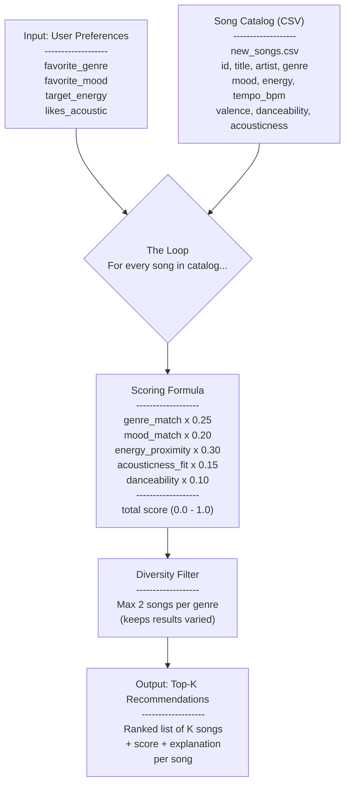
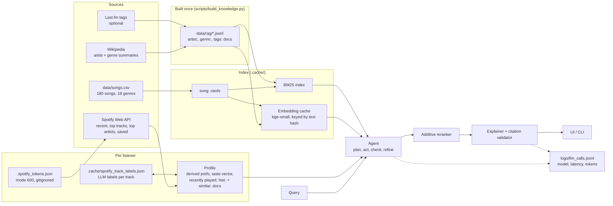
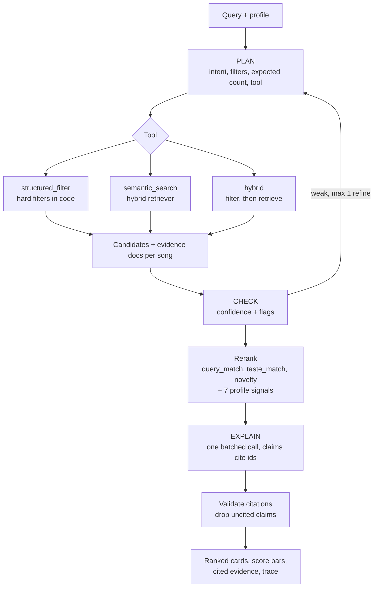

# Music Recommender - Data Flow

## Original System (v1)

The first version: a fixed profile scored against every song in the catalog.

## Current System: Agentic RAG + Spotify

The scoring idea from v1 survives as the 7 profile signals inside an additive reranker. Around it, an agent plans and checks retrieval over a small knowledge store, and an optional Spotify login turns listening history into a profile, a taste vector, and citable evidence.

### Pipeline per query

### What data goes where

| Data | Where it lives | Leaves the machine? |
|---|---|---|
| Song catalog, knowledge docs | `data/` (in the repo) | No |
| Embeddings, BM25 index | `.cache/` | No (embeddings run locally) |
| Spotify tokens | `.spotify_tokens.json`, mode 600, gitignored | Only to Spotify |
| Listening history | in memory; Streamlit caches it for 30 min | No |
| History track labels (title, artist → genre, mood, energy) | `.cache/spotify_track_labels.json` | Titles and artists of unmatched tracks are sent to Claude once, for labelling |
| Query, catalog snippets, evidence | in memory | Sent to Claude for plan, check, and explain |
| LLM call log | `logs/llm_calls.jsonl` | No. Holds model, latency, and token counts, not prompts |

To remove your Spotify data: click **Disconnect Spotify** (deletes the tokens), then delete `.cache/spotify_track_labels.json`.
