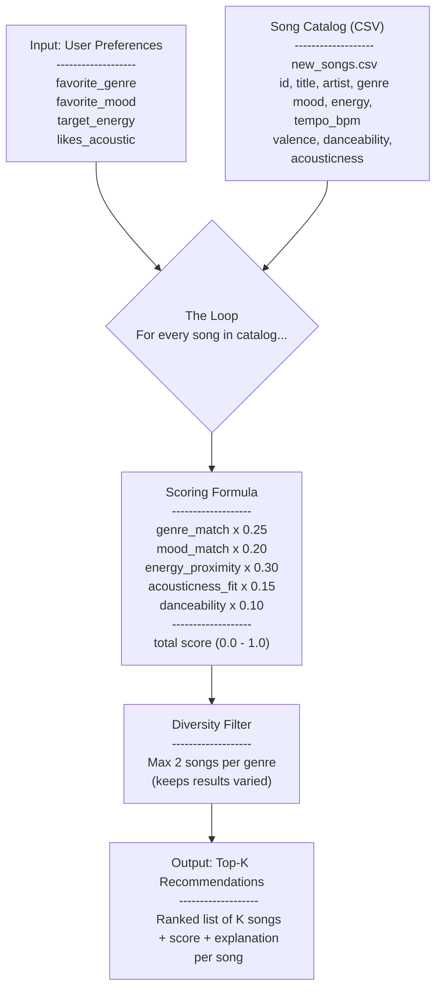
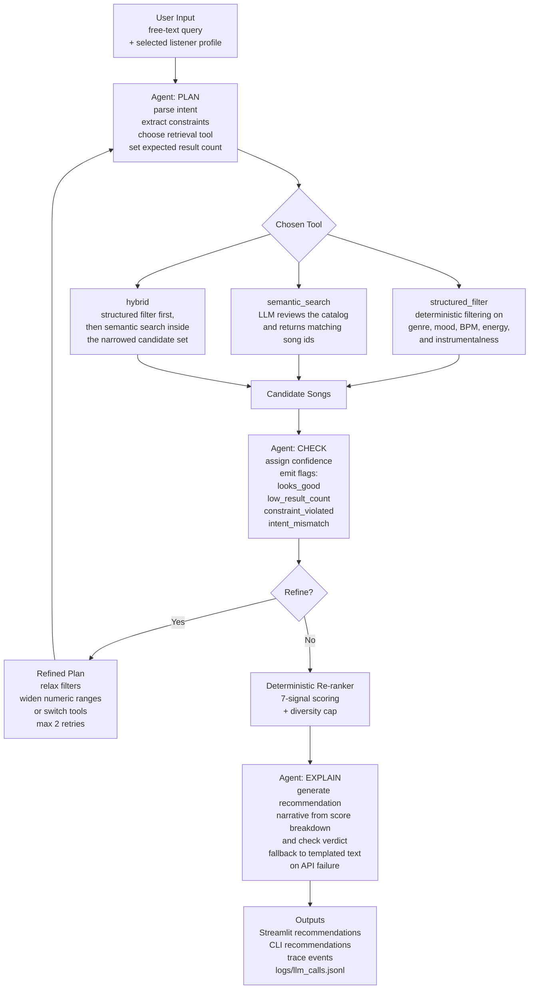

# Music Recommender - Data Flow

## Extended System: Agentic Workflow Data Flow

The original deterministic data flow above is still part of the project. The extended system adds an LLM-driven orchestration layer in front of that scorer so the app can accept free-text requests, choose retrieval behavior, evaluate candidate quality, and explain the final recommendations.

### Notes On The New Flow

- The original rule-based recommender is still the final ranking authority.
- The new AI layer adds a `plan -> act -> check -> respond` loop.
- Retrieval is dynamic: the agent can choose `structured_filter`, `semantic_search`, or `hybrid`.
- The system now exposes confidence, flags, trace events, and structured LLM logs as reliability signals.
- If the first pass looks weak, the refine loop can broaden or switch retrieval strategies before ranking.
